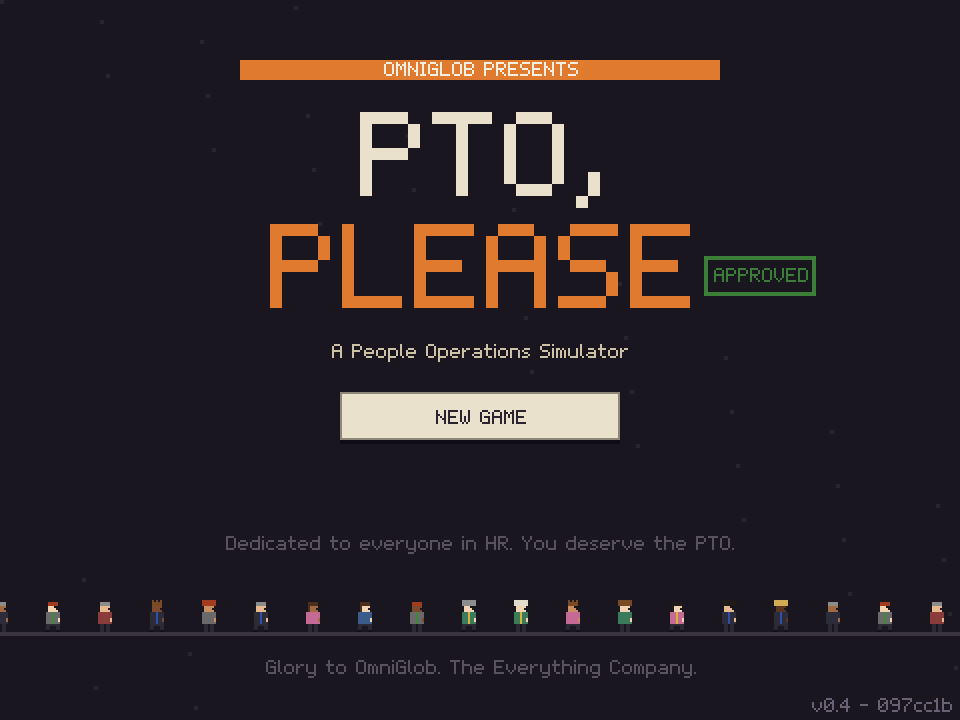
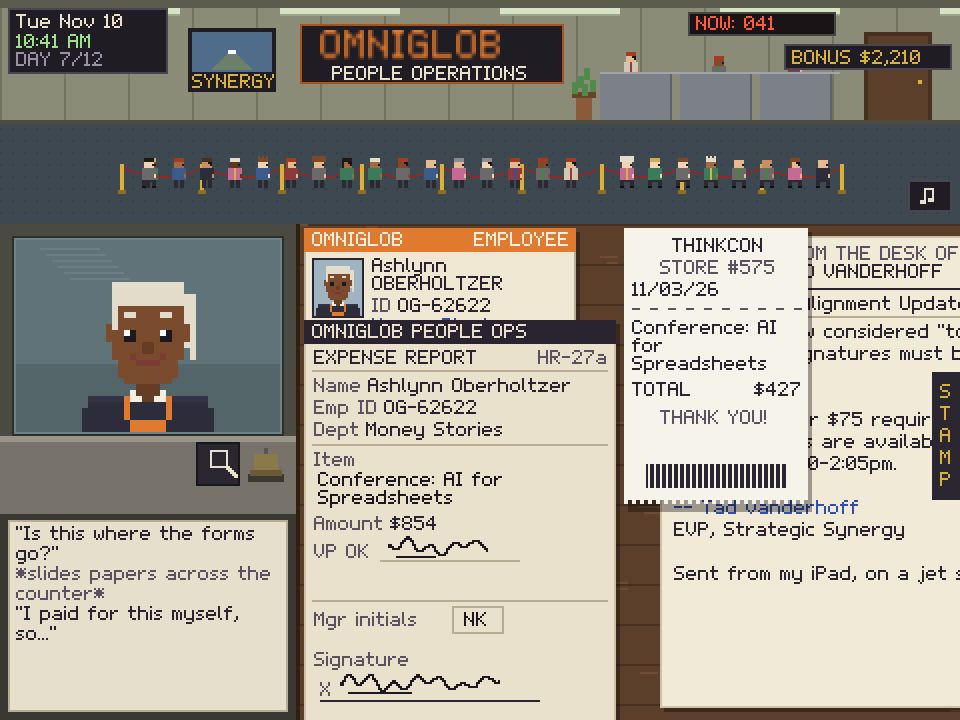
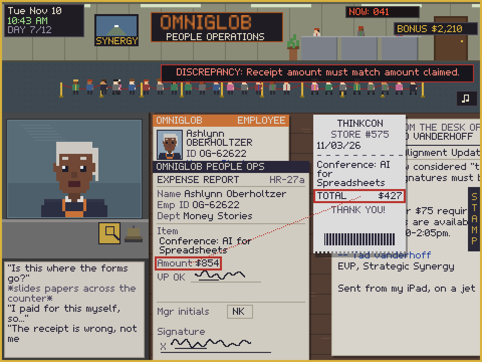
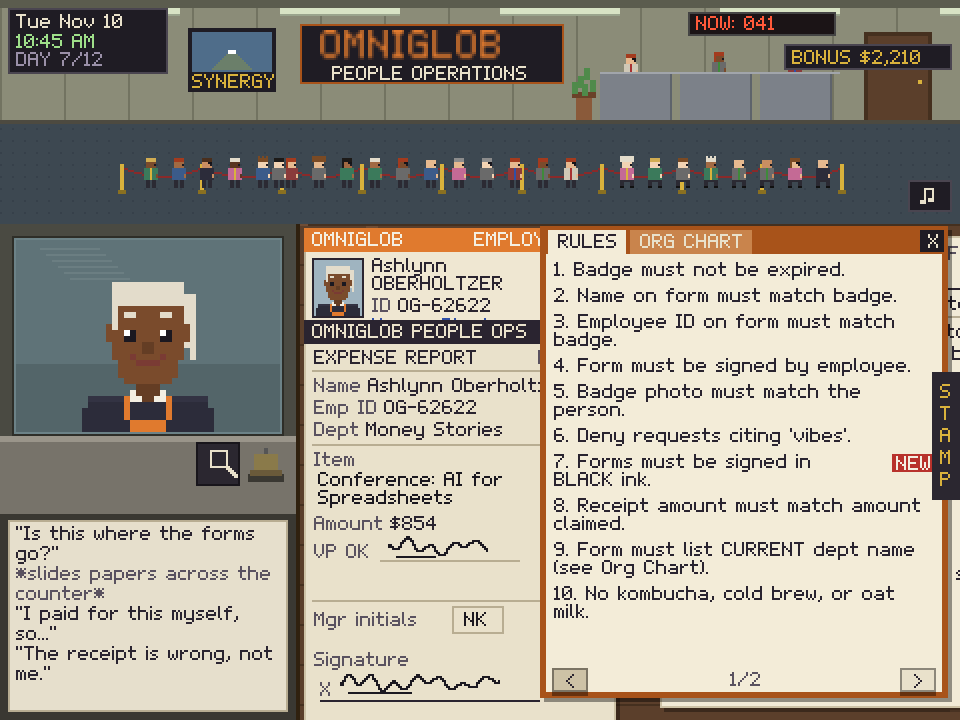
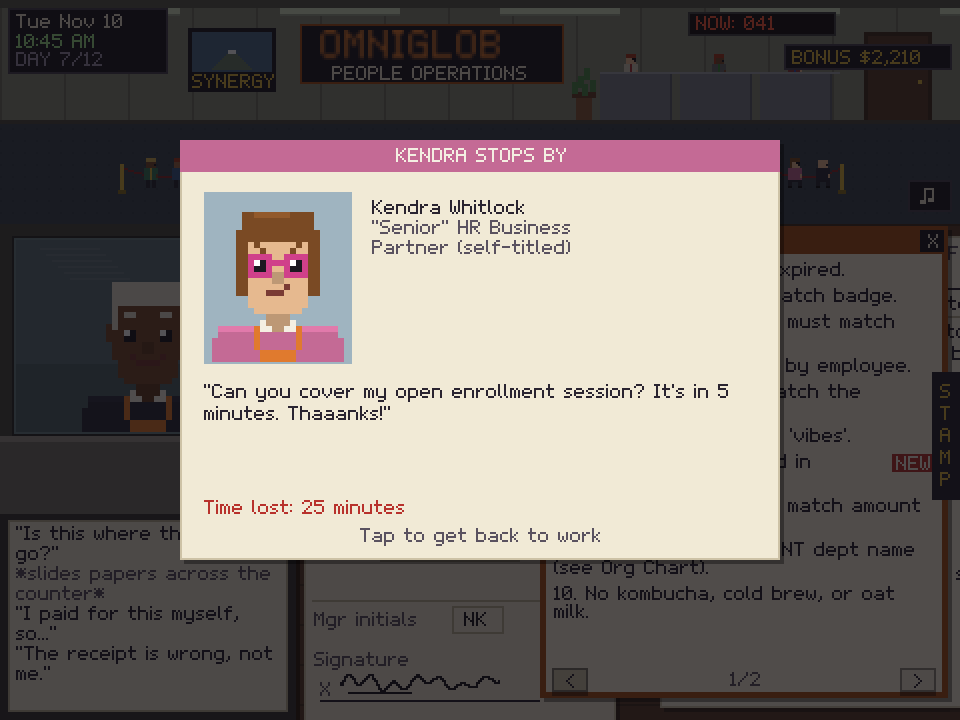
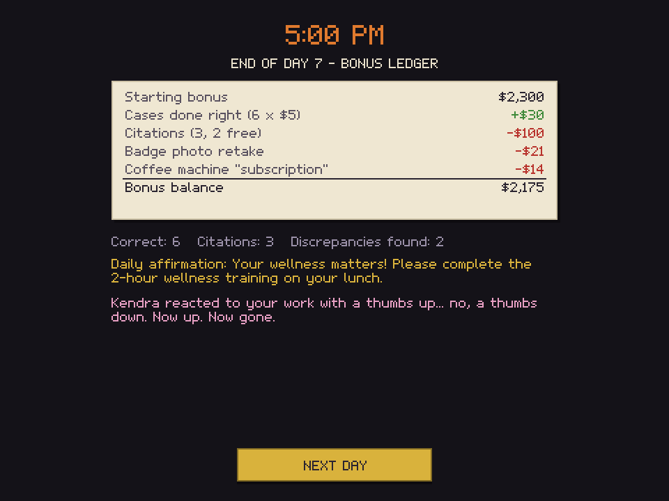

# PTO, Please

**A People Operations simulator. Glory to OmniGlob.**

### ▶ [Play it now: captaincoder.github.io/ptoplease](https://captaincoder.github.io/ptoplease/)

  

You are the last sane person in People Operations at **OmniGlob, The Everything Company**.
Every morning, senior leadership sends a new memo that changes the rules. Every day, employees line up
at your window with PTO requests, expense reports and job offers. Check their paperwork against the
Employee Handbook, stamp it, hand it back, and try to hold on to your (very small) bonus for 12 days,
until your Annual Review.

It's an 8-bit, browser-based puzzle game in the spirit of *Papers, Please*, only with fewer border
checkpoints and many more lanyards.

## How to play

1. **Read the memo** on your desk. It lists new rules and changes to old ones.
2. **Tap the gold bell** to call the next employee to your window.
3. **Drag (or tap) their papers** from the counter onto your desk.
4. **Check the paperwork against the handbook** (the orange book). New rules are marked **NEW**.
5. **Open the STAMP tab** on the right edge of your desk. Slide the *form* under a stamp and tap
   **APPROVE** or **DENY**. After the CEO's nephew shows up, you also get **ESCALATE**.
6. **Drag the stamped form back** to the employee.

Stuck? Tap the **magnifier**, then tap two things that should match (a name on the form and the badge,
a receipt total and the amount claimed, even the person and their badge photo). If they don't match,
you'll get a discrepancy, and the employee will make an excuse.

### Scoring

| | |
|---|---|
| Correct call | +$5 kudos |
| First two citations each day | Warning only |
| Each later citation | -$100 from your bonus |
| End of day | "Voluntary" deductions (Cabo offsite fund, lanyard replacement fee...) |
| Bonus reaches $0 | Performance Improvement Plan (game over) |

Every run is different. Which edicts arrive, when they change or get rescinded, which departments get
renamed, and when expense reports, job offers and the CEO's nephew show up are all shuffled each time.

## Screenshots

| | |
|---|---|
|  |  |
|  |  |
|  | |

## Playing on iPad

The game is built for iPad in **landscape** with touch controls. It also works with a mouse on a computer.

- For full-screen play, open the page in Safari, tap **Share**, then **Add to Home Screen**.
- No sound? Tap the **♪** button in the top right to toggle music, and check that your iPad isn't in
  silent mode.
- Progress is saved on your device at the end of each day. Tap **Continue** on the title screen to resume.

## Questions

**Does it need an account or install?** No. It runs entirely in your browser.

**Does it collect anything?** No. There are no analytics, ads or accounts. The only thing stored is
your save game and music setting, in your own browser.

**What's the number in the corner of the title screen?** The build version, like `v0.12 - a1b2c3d`. Include it if you report a bug.

**Found a bug, or have a better memo?** [Open an issue](https://github.com/captaincoder/ptoplease/issues).

## About

Made by Richard ([captaincoder](https://github.com/captaincoder)) as a love letter to everyone who has
ever had to enforce a policy that changed overnight.

OmniGlob and every character in the game are made up. Any resemblance to your actual workplace
is a coincidence and probably also a policy violation.

Inspired by *Papers, Please* by Lucas Pope. This is an independent project and is not affiliated with
or endorsed by him. All art, names and text are original.

## License

[MIT](LICENSE)
